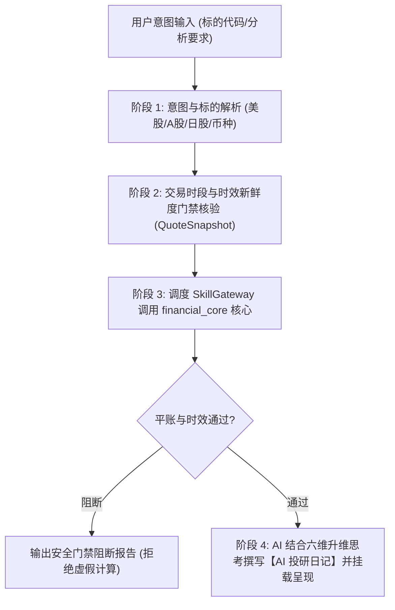

# 水源分析 Agent Skill (v5.0.0 买方高维认知与闭环反思版)

买方机构级股票分析、法证审计、六维升维思考与交易决策协同交互层。

> [!IMPORTANT]
> **程序、AI 与投研闭环核心原则 (The Core Tri-Pillar Principles)**:
> 1. **程序只负责坚硬的骨架 (Objective Quantitative Skeleton)**：
>    - 官方三表平账核验（Stage 1 门禁）：资产与（负债+权益）不平账或现价/股数非法时刚性阻断，严禁输出假估值；
>    - 交易时段与时效硬门禁：解析交易时区与日历，未来时间戳刚性拦截，旧日缓存自动降级为前收盘价基准；
>    - 确定性量化数学计算：法证五刀穿透、多情景 DCF 独立复算、CRR 美式期权二叉树、跨市场宏观流动性加压；
>    - 结构化数据卡片呈现：以统一、严谨的富文本卡片呈现客观指标、估值矩阵与多币种符号；
>    - **严禁程序越界输出机械武断的定论**：废除硬编码买卖评级与固定 5%/15% 虚假半凯利仓位，无校准概率时严格展示为“待定”。
> 2. **AI 负责赋予六维立体的思考血肉 (Multi-Dimensional Buy-Side Cognitive Flesh)**：
>    - 彻底破除“机械定清单（Checklist Bureaucracy）”与“一阶线性思维”；
>    - 必须从**微观流动性反身性、跨期因果与索罗斯反身性、资金期限错配、非对称凸性工程、前置证伪红线、产业链生态位**六大高阶认知维度开展推演；
>    - 在决策卡片底部的 `### 📝 【AI 投研日记与定性归纳】` 专区中撰写富有质感的深度买方投研日记。
> 3. **系统闭环复盘与贝叶斯自我演进 (Retrospective Reflection & Bayesian Evolution)**：
>    - 拒绝简单的对账算术或生硬机械规则；
>    - 每日对账前期预测走廊与今日真实结算，从流动性踩踏、预期差反转、对手盘被迫平仓等深层机理执行四维法证归因；
>    - 动态联合校准贝叶斯先验矩阵（更新波动率溢价、安全边际缓冲与仓位分配分布）。

---

## 1. 触发场景与意图路由

当用户提出以下需求时，Agent 应激活本技能：
- **个股系统性投研分析**：“分析 RXRX 是否值得买”、“五粮液现在估值合理吗”、“帮我分析 NVDA”；
- **法证级财报穿透审计**：“排查某公司有没有财务粉饰”、“看看这家公司存货和现金有没有毒”；
- **估值走廊与安全边际**：“给个目标价和止损底价”、“中性内在价值公允锚点是多少”；
- **衍生品与宏观压力测试**：“美式期权二叉树公允价是多少”、“日元套息平仓对该股影响多大”；
- **全市场低估筛选**：“筛选当前处于低估走廊且通过法证审计的优质标的”；
- **跨期投研复盘与反思归因**：“复盘前几天的分析结果”、“为什么今天预测出现偏差”、“提取认知盲区与贝叶斯更新”。

---

## 2. 买方高阶投研认知模型与六维立体推演体系 (Elevated Buy-side Cognitive Framework)

买方投研绝非机械地套用指标或填写静态检查单。市场是复杂自适应系统（Complex Adaptive System），Agent 必须在每一次投研输出中运用以下六大升维认知模型：

### 维度 1: 微观流动性与订单流反身性 (Microstructure & Liquidity Reflexivity)
- **价格是流动性交易出来的，而非公式计算出来的**。
- 必须穿透分析做市商（Market Makers）的 Gamma/Delta 敞口状态：
  - 当股价跌破密集虚值认购期权（OTM Call）行权价时，做市商为维持 Delta 中性被迫在现货市场加速抛售，形成**“现货下跌 $\to$ 做市商抛售 $\to$ 流动性枯竭 $\to$ 现货进一步暴跌”的 Gamma 陷阱（Gamma Trap）**；
  - 洞察“基本面破位”与“订单簿流动性瞬间抽干导致的假摔踩踏”的本质区别。
- 识别借券融券成本（Borrow Fee / Utilization Rate）与空头回补挤压（Short Squeeze）动能。

### 维度 2: 跨期因果与索罗斯反身性 (Soros Reflexivity & Multi-Order Causality)
- **跳出一阶线性思维（“利好=涨，利空=跌”）**：
  - **二阶思维（预期差 Expectation Gap）**：市场当前一致预期是什么？盘面当前价格已经计入（Priced-in）了多少极端悲观/乐观情景？当所谓的利空（如国会听证会、监管草案）早已在股价暴跌中被过度贴现时，实质利空落地往往成为反转的黄金击球点；
  - **三阶思维（反身性 Reflexivity）**：股价的大幅波动是否会反向改变企业的实体基本面？
    - 对于缺钱的轻资产/创新研发企业，股价崩塌会导致增发无门、现金跑道断裂；
    - 对于坐拥充沛自由现金流的行业巨头（如 UNH、BMY、GOOGL），股价超跌不仅不伤害经营，反而让管理层能够以极低估值大额注销式回购、低成本吞并出清对手，反向加速每股内在价值的膨胀。

### 维度 3: 资金期限错配与对手盘博弈画像 (Capital Horizon Mismatch & Counterparty Profiling)
- **投研不仅是看公司，更是看牌桌对面的对手是谁**：
  - 穿透谁在主导抛售：是面临季度排名、VaR 风险预算清盘线、散户赎回压力的公募/杠杆基金（被迫清算者 Forced Sellers），还是具备无限耐心的产业资本？
  - **时间跨度套利 (Time Horizon Arbitrage)**：买方机构最坚固的护城河是“资金期限的宽容度”。在被迫交易者因短期摩擦抛出带血筹码时，以流动性提供者姿态逆向接盘，获取超额风险溢价。

### 维度 4: 非对称凸性与损益分布工程 (Asymmetric Convexity & Payoff Architecture)
- **严禁散户化的单点裸赌方向（如单边裸买深度虚值期权，直面 Theta 极速归零与波动率暴跌 Vol Crush）**。
- 从头寸结构上追求**非对称凸性（Convexity）**：
  - 运用波动率曲面（IV Skew/Smile）构建跨期日历价差（Calendar Spread）、现货加保护性看跌领子策略（Collar）或合成多头；
  - 确保“在看错或震荡时，损失被确定性的安全垫严格锁定；而在催化剂爆发兑现时，享有非线性向上暴击收益”。

### 维度 5: 前置证伪承诺与反事实贝叶斯迭代 (Falsification Pre-commitments & Epistemic Humility)
- **所有投资论点必须前置声明“证伪指标清单（Falsification Triggers）”**：
  - 明确写出：“如果发生指标 X（如核心管线 III 期终点落空、大客户留存率跌破 80%、自由现金流连续 2 季转负），无条件承认论点错误并执行斩仓，严禁将逻辑证伪辩解为市场非理性”；
  - 在价格走势偏离预期时，严格区分**“逻辑证伪型偏离”**与**“流动性噪音型偏离”**，依据贝叶斯法则动态校准先验胜率与赔率分布。

### 维度 6: 产业生态位共振与定价权迁移 (Ecosystem Niche & Pricing Power Shift)
- 将单体标的置于完整产业链拓扑网络中审视：
  - 追踪瓶颈环节（Chokepoints，如 CoWoS 封装、特种冷却液、电力变压器）与定价权流动；
  - 评估企业是正在享受产业链的“利润虹吸”，还是正在被上游供应商与下游寡头客户“双向挤压毛利”。

---

## 3. 核心执行流程 (SOP 四部曲升级版)



### 阶段 1: 意图与标的解析
- 识别目标股票代码与市场归属：美股 (`RXRX`, `NVDA`)、A股 (`000858`, `600519`)、日股 (`7203`)；
- 明确分析模式：`full_systemic`（默认全流程系统性分析）、`forensic_only`（纯法证体检）、`macro_stress`（宏观冲击测试）。

### 阶段 2: 行情时效与交易时段硬核验 (Freshness Gatekeeper)
严格遵守 **2026-10-14 行情数据时效性与当日新鲜度强制核验硬约束**：
- 严禁在未核验时间戳的情况下直接引用行情；
- 自动绑定交易所当地时区（美股 EDT/EST、A股 CST、日股 JST）并对齐交易日历；
- 每次输出前必须显式标注准确时间戳与时段状态（实时、延迟、前收盘基准）；严禁把未来时间或历史缓存当作盘中实时现价。

### 阶段 3: 调度 Skill 网关调用金融核心
在 Agent 执行环境中，通过 `skill_gateway` 发起分析调用：
```python
from skill_gateway import default_gateway

response = default_gateway.handle_equity_analysis(
    ticker="000858",
    market_session="closed",
    quote_timestamp="2026-10-14 15:00:00 CST",
    mode="full_systemic",
    allow_demo=True,
    ai_journal="【AI 投研日记】实地草根调研显示普五批价在 930-940 元企稳，社会库存回落至 1.5 个月良性区间。"
)
print(response["markdown_card"])
```

### 阶段 4: AI 撰写六维深度投研日记与卡片交付
决策卡片结构：
1. **头部档案与时效凭据**：标的名称、代码、市场/币种、时效徽标与营业钟点状态；
2. **核心量化指标与客观信号看板**：内生公允锚点、现价安全边际、现金跑道状态、组合建议仓位（无校准胜率时严格为“待定”）；
3. **多情景估值复算走廊 (Valuation Matrix)**：悲观防线、中性基准、乐观靶心，展示真实的 WACC、g、清算级破产底（NCPS/NCAV）；
4. **法证级证据穿透体检 (Forensic Dissection)**：红黄牌统计及受限现金、存货毒性等审计明细；
5. **宏观压力测试与衍生品结构 (Macro & Options)**：日元套息平仓估值下折、CRR 美式期权二叉树公允价与提前行权溢价；
6. **📝 【AI 投研日记与定性归纳】 (AI Research Journal)**：
   > [!IMPORTANT]
   > AI 撰写投研日记时，必须显式穿透并落地以下四大模块，严禁输出泛泛模板：
   > - **【微观流动性与对手盘博弈透视】**：当前订单簿状态、做市商对冲盘压力、谁在被迫卖出；
   > - **【二阶预期差与反身性推演】**：市场计入了什么悲观预期、利空落地后企业基本面是否发生恶性反身性；
   > - **【前置证伪指标与反事实防线】**：明确列出哪 2~3 个具体硬指标触发时承认投资逻辑被证伪；
   > - **【非对称凸性结构建议】**：头寸配置设计（网格分批、现货底仓搭配对冲、规避临期虚值期权）。

---

## 4. 投研闭环复盘反思与贝叶斯自我演进协议 (Retrospective Reflection Protocol)

系统内生集成 [`finance_tools/retrospective_review_engine.py`](finance_tools/retrospective_review_engine.py)，在每日早 07:00（美股收盘）与 16:00（日股收盘）自动执行跨期闭环复盘：


### 多维认知反思与归因执行法则：
1. **流动性冲击 vs 逻辑证伪诊断**：
   - 若股价超预期下跌，首先排查是否遭遇做市商负 Gamma 对冲抛售或被迫平仓踩踏；
   - 检验前置证伪红线是否被击穿；若证伪红线未破且净现金底座稳固，判定为**流动性错杀**而非基本面恶化；
2. **预期差吸收进度评估**：
   - 评估当前实际走势中，市场对利空/利好事件的消化程度（Over-discounted vs Under-appreciated）；
3. **凸性风险与期权损益审计**：
   - 严苛核验期权策略是否规避了虚值到期归零风险，量化评估 1/4 凯利现货对冲效果；
4. **贝叶斯先验矩阵动态演化**：
   - 绝非机械地硬编码规则，而是以概率分布形式动态调整：
     - **超跌安全边际冗余系数**：针对遭遇政治监管恐慌但现金流充沛的蓝筹，动态扩宽左侧建仓走廊；
     - **做市商抛售修正系数**：针对小盘高波动股，在跌破关键行权价后自动冻结期权多头推荐，转为现货保守网格。

---

## 5. 架构分层职责与统一入口清单

| 层次 | 目录/文件 | 核心职责 | 依赖关系 |
|:---|:---|:---|:---|
| **金融分析核心层 (Financial Core)** | `financial_core/` | 纯数学量化模型、法证五刀手术刀、情景 DCF 估值、期权二叉树、破产清算底、宏观压力测试、独立 CLI | **零依赖** Skills 或 Agent，独立买方量化库 |
| **Skill 适配网关层 (Skill Gateway)** | `skill_gateway/` | 交易时段时效门禁核验、输入校验、调度金融分析核心、AI 六维投研日记挂载、决策卡片渲染 | 依赖 `financial_core` 公开发布的 API 契约 |
| **投研复盘反思引擎 (Retrospective Engine)** | `finance_tools/retrospective_review_engine.py` | 跨期预测底账追踪、盘面真实结算、六维量化归因、认知盲区剖析、贝叶斯先验校准 | 依赖 `QuoteFreshnessGateway` |
| **Agent 技能契约层 (Skill Contract)** | `SKILL.md` | 定义技能触发意图、六维高阶认知框架、SOP 四部曲、复盘反思协议、交互规范 | 面向 Agent 与宿主环境的声明性契约 |
| **批量自动化流水线** | `scripts/run_10k_universe_pipeline.py` | 全盘资产池批处理调度、断点续传、本地渲染与云端上传状态机 (RENDERED_LOCAL -> UPLOADED) | 批处理生产入口 |
| **复盘反思全景研报生成器** | `scripts/run_retrospective_review_pipeline.py` | 历史预测与当期盘面对账、六维反思白皮书渲染、云端 Drive 自动上传 | 复盘闭环流水线 |

---

## 6. CHANGELOG

- **v5.0.0 (2026-10-15)**: **买方高阶投研认知模型与投研闭环复盘反思体系全面上线**。
  - **彻底破除机械清单主义**：确立微观流动性反身性、跨期因果与索罗斯反身性、资金期限错配与对手盘画像、非对称凸性工程、前置证伪红线、产业链生态位共振六大升维认知模型；
  - **投研日记深度升级**：强制要求 Stage 4 AI 投研日记穿透微观流动性、二阶预期差、前置证伪指标与非对称凸性建议四大模块；
  - **投研闭环复盘引擎重构**：实现预测与结算自动对账、四维法证归因（Alpha/Beta/走廊/期权）、深层认知盲区反思与贝叶斯先验联合更新；
  - **测试与知识库 100% 回归**：保证全套测试套件、知识库结构、数据仓库治理全部通过。
- **v4.1.1 (2026-10-15)**: 深度自检五大隐患专项精细修复与官方底账解析器上线。
- **v4.1.0 (2026-10-15)**: 工程整改与人机协同深化架构（平账刚性门禁、交易时钟区间核验）。
- **v4.0.0 (2026-10-14)**: 金融分析与 Skills 彻底物理与逻辑解耦。
