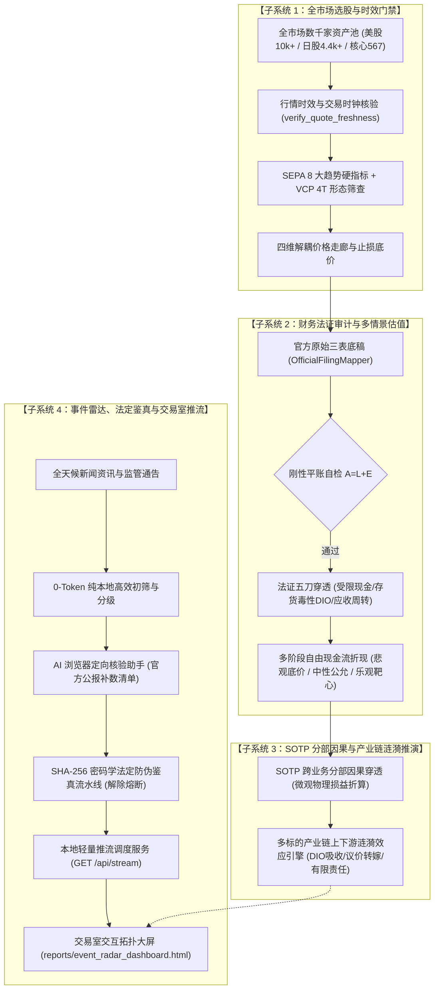
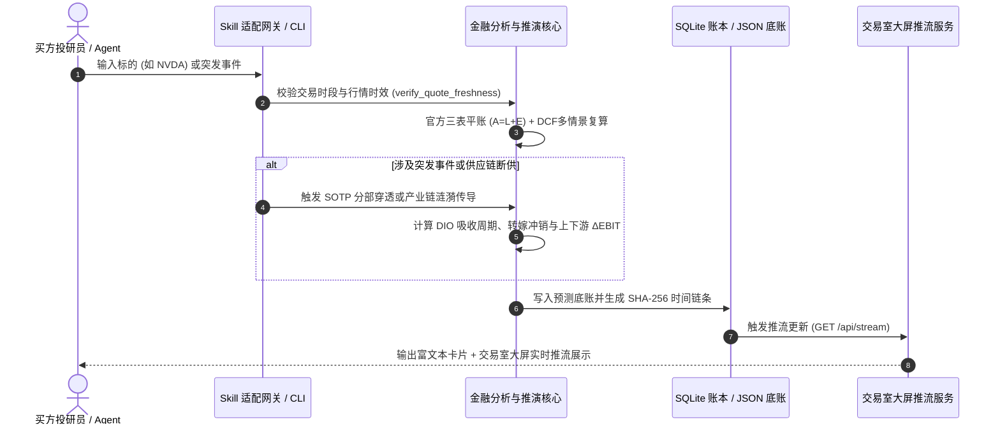

# 水源分析 Agent Skill (v6.1.0 买方全景量化、失效防御与分包架构版)

买方机构级股票量化选股、微观法证审计、SOTP 业务分部穿透、多标的产业链涟漪传导矩阵、全天候事件雷达推流大屏与 6 大业务工具子包架构。

> [!IMPORTANT]
> **程序、AI 与投研闭环三大刚性原则 (The Core Tri-Pillar Principles)**:
> 1. **程序只负责坚硬客观的数据骨架 (Objective Quantitative Skeleton)**：
>    - **官方三表刚性平账自检**：$Assets = Liabilities + Equity$ 不平账或现价/股数非法时刚性阻断，严禁输出虚假估值；
>    - **交易时段与时效硬核验门禁**：自动绑定交易所当地时区（美股 EDT/EST、A股 CST、日股 JST）并对齐交易日历，未来时间戳刚性拦截，旧日缓存自动降级为前收盘价基准；
>    - **确定性量化数学计算**：SEPA 8 大趋势硬指标、VCP 4T 波动收缩、多情景 DCF 估值矩阵、SOTP 分部损益穿透、存货周转天数 (DIO) 吸收周期与产业链涟漪因果传导矩阵；
>    - **严禁程序越界输出机械武断的定论**：废除硬编码买卖评级与固定虚假仓位，无校准概率时严格展示为“待定”。
> 2. **AI 负责赋予六维立体的思考血肉 (Multi-Dimensional Cognitive Flesh)**：
>    - 彻底破除“机械清单主义（Checklist Bureaucracy）”与“一阶线性思维”；
>    - 必须从**微观流动性反身性、跨期因果与索罗斯反身性、资金期限错配与对手盘画像、非对称凸性工程、前置证伪红线、产业链生态位共振**六大高阶认知维度开展推演；
>    - 在决策卡片底部的 `### 📝 【AI 投研日记与定性归纳】` 专区中撰写富有商业洞察的买方投研日记。
> 3. **系统闭环复盘与贝叶斯自我演进 (Retrospective Reflection & Bayesian Evolution)**：
>    - 每日对账前期预测走廊与今日真实结算，从流动性踩踏、预期差反转、对手盘被迫平仓等深层机理执行四维法证归因；
>    - 动态联合校准贝叶斯先验矩阵（更新波动率溢价、安全边际缓冲与仓位分配分布）。

---

## 一、 触发场景与意图路由矩阵 (Trigger Matrix)

当用户提出以下任一诉求时，Agent 必须主动激活本技能并路由至对应的专业处理流水线：

| 用户核心意图 | 典型自然语言触发词 | 核心调度入口 / 工具 | 输出交付物规范 |
| :--- | :--- | :--- | :--- |
| **全市场选股与趋势扫描** | “帮我选股”、“挑几只趋势好的标的”、“扫描纳指/日经优质突破股” | `finance_tools.sepa_buy_signal_engine`<br>`scripts.run_10k_universe_pipeline` | SEPA 趋势筛选卡片、买点价格走廊、VCP 收缩形态、止损保护线 |
| **个股系统性深度投研** | “分析 NVDA / 7203 / 五粮液”、“测算某公司合理估值”、“排查财务粉饰” | `skill_gateway.default_gateway`<br>`scripts.generate_deep_dossier` | 买方深度研报档案 (Deep Dossier)、官方三表清洗、多情景 DCF 估值矩阵 |
| **多业务分部 (SOTP) 穿透** | “某公司云业务停机损失多少”、“分部拆解公司估值”、“SOTP 因果穿透” | `finance_tools.sotp_event_analyzer`<br>`scripts.run_sotp_event_penetration` | SOTP 分部加总估值表、微观物理损益穿透报告、净利冲击百分比 |
| **产业链上下游涟漪效应推演** | “台积电停电影响苹果和ASML多少”、“某代工厂断供上下游如何传导”、“产业链涟漪分析” | `financial_core.engines.supply_chain_ripple_engine`<br>`scripts.run_supply_chain_ripple_analysis` | 产业链非对称涟漪传导矩阵、DIO 吸收周期、议价转嫁冲销、各标的 $\Delta EBIT$ 测算 |
| **突发事件监控与法定鉴真** | “最近有什么重大消息”、“排查某传闻真伪”、“启动事件雷达” | `finance_tools.event_radar_collector`<br>`finance_tools.evidence_verification_pipeline` | 0-Token 事件初筛底账、AI 浏览器核验清单、SHA-256 法定鉴真防伪收据 |
| **本地买方交易室推流看板** | “打开监控大屏”、“启动交易室推流服务”、“查看拓扑大屏” | `scripts.serve_radar_dashboard`<br>`scripts.generate_radar_dashboard` | 本地轻量推流 HTTP 服务 (`http://127.0.0.1:8899`)、交互拓扑大屏 |

---

## 二、 六大核心业务子系统与量化模型架构



### 1. 全市场选股与时效门禁子系统 (Stock Selection & Freshness Gate)
- **覆盖资产池**：
  - 美股：纽交所与纳斯达克全市场 10,000+ 家上市企业 (`data/universe/sec_company_tickers.json`)；
  - 日股：东证全市场 Prime/Standard/Growth 4,400+ 家企业 (`data/universe/jpx_company_tickers.json`)；
  - 顶层核心池：Tier 0 / Tier 1 核心 567 重点标的。
- **初筛数据边界与 0-Token 纯本地物理计算铁律**：
  - 初筛仅依赖标的过去 1 年（约 200~250 交易日）的客观日 K 线价量时序 (Daily OHLCV)；
  - 纯本地执行 50/150/200 日移动均线、52 周高低点、成交量萎缩度及 VCP 波动收缩形态收敛计算；
  - **初筛阶段严格禁止调用大语言模型 (LLM)**，严禁向上下文注入全量原始财报，实现 0-Token 秒级全市场数千家上市主体初筛；
  - 仅在初筛全票通过（进入第二阶段主升浪且形态收敛就绪）后，才允许向深度分析管道准入，调用官方三表底稿、DCF 估值并撰写深度买方研报日记。
- **最新日期核心数据拉取完成度强制前置声明门禁 (`finance_tools.data_readiness_tracker`)**：
  - 每次向用户输出股票分析、选股或研报前，强制前置调用数据完备度追踪器查验本地落盘底账；
  - 强制在回复开头显式声明：当前探测到的最新基准日期（如 `2026-11-07`）、已完成拉取的标的分类清单（宏观指数与个股）及数据完备度判定。
- **SEPA 8 大趋势硬指标**：
  1. $Price > MA50 > MA150 > MA200$
  2. $MA200$ 处于上升通道至少 1 个月
  3. $Price \ge 1.25 \times 52W\_Low$
  4. $Price \ge 0.75 \times 52W\_High$（距离 52 周新高回撤不超过 25%）
  5. 波动收缩形态 (VCP 4T: 振幅逐级收敛 $20\% \to 10\% \to 5\% \to 2\%$)
- **交易时段时效硬核验门禁 (`verify_quote_freshness`)**：
  - 必须绑定交易所当地时区（美股 EDT/EST、A股 CST、日股 JST）并对齐交易日历；
  - 严格区分盘前 (Pre-Market)、盘中 (Regular)、盘后 (After-Hours) 与前收盘价基准；
  - 未来时间戳刚性拦截，旧日缓存自动降级并显式告警，严禁旧数据冒充盘中现价。

### 2. 财务法证审计与多情景 DCF 估值子系统 (Forensic Audit & Scenario DCF)
- **官方三表底稿清洗与刚性平账自检**：
  - 任何录入主管道的财报底账必须通过 $Assets = Liabilities + Equity$ 刚性平账自检；
  - 经由 `OfficialFilingMapper` 转换非标字符串，严禁未清洗字符串直传核心。
- **存货周转天数 (DIO) 与供应链上下游集中度**：
  - $DIO = \frac{\text{Average Inventory}}{\text{COGS}} \times 365$
  - 穿透上下游前五大客户与核心供应商采购/销售集中度，识别单一依赖风险。
- **长短期差异化情景 DCF 估值矩阵**：
  - 悲观防线 (Pessimistic Floor)：折现率上浮 150-200bps，永续增长率 $g$ 降至 $1.5\%$，测算清算级破产底（NCPS/NCAV）；
  - 中性公允 (Neutral Anchor)：基准 WACC 与行业公允 $g$；
  - 乐观靶心 (Optimistic Target)：反映护城河扩张与自由现金流超预期增长。

### 3. SOTP 跨业务分部微观因果损益穿透子系统 (SOTP Segment Penetration)
- **业务分部画像结构**：依据 `config/sotp_profiles.json`，将综合性巨头拆解为独立分部（如 Alphabet: Google Search, YouTube, Google Cloud, Other Bets）；
- **微观物理损益折算模型**：
  $$\Delta EBIT_{total} = \sum_{i} \left( \text{SegmentEBIT}_{i} \times \text{ImpactPct}_{i} \right)$$
  - 支持突发业务冲击（如“云数据中心断电 3 天导致服务可用性下降”、“核心晶圆厂减产 $15\%$”），精确量化至每股税后收益 (EPS) 与股权公允折现值。

### 4. 多标的产业链上下游涟漪效应传导矩阵子系统 (Supply Chain Ripple Effect)
- **全链拓扑架构**：依据 `config/supply_chain_topologies.json`（严格通过 JSONSchema 验证）：
  $$\text{上游核心设备/原材料供应商} \longrightarrow \text{核心中枢制造/代工厂} \longrightarrow \text{下游大客户/终端品牌}$$
- **存货周转天数 (DIO) 吸收周期数学模型**：
  $$\text{UncoveredDays} = \max(0.0, T_{\text{disrupt}} - DIO)$$
  $$\text{ExposureRatio} = \frac{\text{UncoveredDays}}{T_{\text{disrupt}}} \quad (\in [0.0, 1.0])$$
  - 若断供天数小于企业自身存货周转天数 ($T_{\text{disrupt}} \le DIO$)，存货完全吸收物理冲击，敞口比例为 $0.0$；
- **核心中枢标的损益与议价转嫁冲销**：
  $$\text{Shock}_{\text{hub}} = \text{BaseShock} \times \text{ExposureRatio}_{\text{hub}}$$
  $$\Delta EBIT_{\text{hub}} = \text{Shock}_{\text{hub}} \times \left(1.0 - \text{PricingPower}_{\text{hub}} \times 0.5\right)$$
- **下游大客户二级传导与衰减**：
  $$\text{EffectiveShock}_{\text{down}} = |\text{Shock}_{\text{hub}}| \times \beta_{\text{down}} \times \frac{\max(0.0, T_{\text{disrupt}} - DIO_{\text{down}})}{T_{\text{disrupt}}}$$
  $$\Delta EBIT_{\text{down}} = - \text{EffectiveShock}_{\text{down}} \times \left(1.0 - \text{PricingPower}_{\text{down}}\right)$$
- **有限责任数学边界防御**：
  - 严禁除零除负，营业利润损益严格被截断在 $[-100.0\%, +50.0\%]$ 的有限责任区间内。

### 5. 突发事件雷达全天候守护与法定信源防伪鉴真子系统 (Event Radar & Legal Verification)
- **0-Token 纯本地高效初筛**：
  - 基于高优先级正则词库对海量盘前/盘中资讯进行本地极速初筛与关键词去噪；
  - 仅对匹配到实体与关键业务分类的高价值资讯调用大模型结构化提取，节省 $95\%+$ Token 消耗；
- **AI 浏览器定向核验助手 (`BrowserVerificationAssistant`)**：
  - 自动为待核验重大传闻生成官方监管（SEC/JPX/EDGAR）、行业协会、公司官网的定向核验补数清单；
- **法定信源 SHA-256 防伪鉴真流水线 (`EvidenceVerificationPipeline`)**：
  - 官方公报原文下载落盘后，通过密码学哈希签名生成防伪鉴真收据（Verification Receipt）；
  - 验签属实后，自动将事件状态从 `Unverified_Rumor` 跃迁为 `Confirmed_Fact`，解除传闻熔断限制。

### 6. 本地买方交易室推流服务与拓扑交互大屏 (Trading Room Live Stream Dashboard)
- **纯标准库轻量推流调度器**：`scripts/serve_radar_dashboard.py` 基于 `http.server`，零物理第三方重量级网络库依赖；
- **交易室动态推流 API 清单**：
  - `GET /api/stream` 或 `/api/live`: 提供探活心跳、未核实传闻熔断计数与增量推流；
  - `GET /api/events`: 导出全量事件雷达底账与分级状态；
  - `GET /api/receipts`: 导出官方公报 SHA-256 防伪鉴真收据清单；
  - `GET /api/supply-chain/topologies`: 导出可用产业链拓扑架构清单；
  - `GET /api/supply-chain/ripple`: 实时计算并推流特定事件的全产业链穿透推演报告；
  - `POST /api/verify`: 接收官方证据文件路径，现场执行验签并解除熔断；
- **交互拓扑大屏**：`reports/event_radar_dashboard.html` 原生支持产业链涟漪效应控制台，动态调整断供天数与冲击强度，即时渲染上下游损益矩阵。

### 7. 金融工具中继层 6 大高内聚子目录分包架构 (`finance_tools/`)
为了解决工具层单目录扁平膨胀、查找费劲的问题，`finance_tools/` 全面解耦重构为 6 大专业业务领域子包，并建立 100% 向下兼容门面：
1. **`finance_tools.screening`**：全市场选股与价格时机引擎（SEPA 8 大趋势硬指标、VCP 4T 波动收缩、万家资产池构建与候选优选排序）；
2. **`finance_tools.forensics_and_valuation`**：财务法证审计与多情景估值模型（法证手术刀排查受限现金/存货DIO/应收周转、三表平账、DCF估值、单位经济学与护城河）；
3. **`finance_tools.risk_and_derivatives`**：风险管理与衍生品定价引擎（美式期权二叉树、期权因果分析、投资组合风险预算、信用违约与极端黑天鹅压力测试）；
4. **`finance_tools.macro_and_ripple`**：宏观冲击与产业链涟漪分析器（宏观传导、SOTP 跨业务分部因果穿透、多标的供应链上下游涟漪效应矩阵与制度风险评级）；
5. **`finance_tools.events_and_verification`**：突发事件雷达与鉴真监控流水线（0-Token 极速初筛、SHA-256 密码学法定信源防伪鉴真、AI 浏览器定向核验助手与告警调度器）；
6. **`finance_tools.governance_and_pipeline`**：数据底账、时效门禁与基础设施管道（数据完备度追踪、行情交易时钟时效门禁、指标管道与不可篡改预测账本）。
- **100% 向下兼容门面保证**：根目录下 42 个历史模块保留完整兼容门面（Facade/Relay），既有脚本与测试用例 `from finance_tools.xxx import yyy` 零破坏直接可用。

---

## 三、 标准操作流程 (SOP 五步闭环)



### 步骤一：标的意图解析与行情新鲜度门禁
在调用任何计算前，必须先通过 `MarketQuoteVerifier` 核验数据时间戳：
```python
from financial_reporting.quote_freshness_gateway import verify_quote_freshness

quote_snapshot = verify_quote_freshness(ticker="NVDA", raw_quote_dict=quote_data)
# 强制断言数据处于合法交易时钟区间内，拒绝未来时间戳
```

### 步骤二：选股与买点走廊测算
```python
from finance_tools.sepa_buy_signal_engine import SEPABuySignalEngine

engine = SEPABuySignalEngine()
signal_result = engine.evaluate_ticker("NVDA", daily_bars_df)
# 输出: trend_template_pass (bool), vcp_stage, base_pivot, stop_loss_price
```

### 步骤三：SOTP 与产业链涟漪效应因果穿透
```python
from finance_tools.supply_chain_ripple_analyzer import SupplyChainRippleAnalyzer

analyzer = SupplyChainRippleAnalyzer()
report = analyzer.analyze_event_ripple(
    event_id="EVT_20261016_TSMC_FAB18_DISRUPTION",
    disruption_days=45.0
)
print(f"核心中枢影响: {report.core_hub_impact.ebit_impact_pct:.2f}%")
for down in report.downstream_impacts:
    print(f"下游客户 {down.entity_name}: 损益 {down.ebit_impact_pct:.2f}% (DIO缓冲: {down.dio_days}天)")
```

### 步骤四：突发事件雷达鉴真与防伪收据
```python
from finance_tools.evidence_verification_pipeline import EvidenceVerificationPipeline

pipeline = EvidenceVerificationPipeline(auto_refresh_reports=True)
receipt = pipeline.verify_single_event(
    event_id="EVT_20261016_TSMC_FAB18_DISRUPTION",
    evidence_file="data/evidence/regulatory_filing.pdf",
    note="官方公报确认"
)
```

### 步骤五：启动交易室推流服务与大屏展示
```bash
# 启动本地推流服务 (默认端口 8899)
python scripts/serve_radar_dashboard.py --port 8899 --open-browser
```

---

## 四、 核心工具脚本与命令行调度清单 (CLI Registry)

| 脚本路径 | 业务核心功能 | 常用命令示例 |
| :--- | :--- | :--- |
| `scripts/run_screening_universe_batch.py` | 万家企业初筛批处理与流式调度管道 (断点续传/150分块) | `python scripts/run_screening_universe_batch.py --market ALL` |
| `scripts/export_qualified_screening_candidates.py` | 初筛准入候选池优选排序与导出 CLI (抽干比/收敛度) | `python scripts/export_qualified_screening_candidates.py --top 20` |
| `scripts/collect_screening_universe_data.py` | 全盘万家初筛资产池数据契约与分块索引构建 | `python scripts/collect_screening_universe_data.py --status` |
| `scripts/check_data_readiness.py` | 最新日期核心数据拉取完成度与时效底账巡检 | `python scripts/check_data_readiness.py` |
| `scripts/run_supply_chain_ripple_analysis.py` | 产业链上下游涟漪传导推演 CLI | `python scripts/run_supply_chain_ripple_analysis.py --event EVT_001 --days 45` |
| `scripts/run_sotp_event_penetration.py` | 跨业务分部 (SOTP) 因果穿透 CLI | `python scripts/run_sotp_event_penetration.py --ticker GOOGL --segment cloud --loss 10` |
| `scripts/serve_radar_dashboard.py` | 交易室轻量推流调度与 API 服务 | `python scripts/serve_radar_dashboard.py --port 8899` |
| `scripts/generate_radar_dashboard.py` | 静态交互拓扑大屏生成器 | `python scripts/generate_radar_dashboard.py` |
| `scripts/run_event_radar_daemon.py` | 事件雷达常驻守护监控服务 | `python scripts/run_event_radar_daemon.py --interval 60` |
| `scripts/generate_deep_dossier.py` | 公司深度投研档案自动化生成 | `python scripts/generate_deep_dossier.py --ticker NVDA` |
| `scripts/generate_daily_briefing.py` | 美股/日股大盘每日研报生成 | `python scripts/generate_daily_briefing.py --market US` |
| `scripts/run_10k_universe_pipeline.py` | 全盘资产池批处理调度流水线 | `python scripts/run_10k_universe_pipeline.py --chunk-size 50` |

---

## 五、 四道架构防劣变验收硬门禁 (Non-Regression Gates)

任何代码与文档改修完成后，必须按顺序执行并通过以下四道硬门禁方可交付：

1. **架构完整性全息巡检**：
   ```bash
   python scripts/verify_architecture_integrity.py
   ```
   - 断言底层纯净金融核心零污染、全量模块导入零环路、门面与底账就绪。
2. **便携 CI 套件与全量单测零失败**：
   ```bash
   python scripts/run_ci.py
   python -m unittest discover -s scripts -p "test_*.py"
   ```
   - 所有测试用例 100% PASS，测试数量只增不减。
3. **四大治理回归全绿**：
   ```bash
   python scripts/test_data_store.py
   python scripts/validate_knowledge_structure.py
   python scripts/test_research_contract.py
   python scripts/test_industry_mapping.py
   ```
4. **不可篡改密码学账本验签**：
   ```bash
   python -c "from financial_core.engines.prediction_ledger import PredictionLedger; assert PredictionLedger().verify_integrity()['tampered'] == False"
   ```

---

## 六、 版本演进记录 (CHANGELOG)

- **v6.1.0 (2026-11-08)**: **实测风控评估报告归档、失效场景防御体系设计与 finance_tools 6 大高内聚子目录分包重构**。
  - **实测风控报告正式归档**：将 10 年 826 标的跨周期对撞回测评估与五大模型实测报告归档入典 (`docs/36-量化交易系统全息评估与风控架构实测报告.md`)；
  - **失效场景防御与增量中枢设计**：落地 Amihud 流动性门禁、Merton 信用破产距离、Beneish M-Score 法证及央行流动性脉冲等系统化防御体系技术设计 (`docs/37-实测失效场景系统化防御体系与增量信息中枢架构设计文档.md`)；
  - **金融工具模块分包重组**：将 `finance_tools/` 扁平膨胀的 42 个模块彻底按业务职能解耦为 `screening/`、`forensics_and_valuation/`、`risk_and_derivatives/`、`macro_and_ripple/`、`events_and_verification/`、`governance_and_pipeline/` 六大高内聚子包，并在根目录提供 100% 向下兼容门面，既有导入零破坏直接复用。
- **v6.0.0 (2026-11-08)**: **全市场选股、SOTP 因果穿透、多标的产业链涟漪矩阵与交易室推流大屏全面封装合流**。
  - **SEPA 趋势选股与时效门禁合流**：整合全市场资产池（美股10k+/日股4.4k+/核心567）扫描、SEPA 8 大硬指标、VCP 4T 收缩、价格走廊与 `verify_quote_freshness` 硬核门禁；
  - **SOTP 多业务分部因果穿透**：上线综合巨头跨业务分部微观物理损益折算模型，告别单一标签粗糙估值；
  - **多标的产业链上下游涟漪效应传导矩阵**：建立存货周转天数 (DIO) 吸收周期、议价转嫁冲销、下游大客户二级传导与有限责任区间数学边界防御机制；
  - **突发事件雷达与法定防伪鉴真**：上线 0-Token 本地初筛、AI 浏览器定向核验助手、SHA-256 密码学公报防伪鉴真流水线与传闻熔断解除机制；
  - **本地买方交易室推流服务**：基于 Python 标准库构建轻量 HTTP 推流服务 (`serve_radar_dashboard.py`)，提供 `/api/stream`、`/api/events`、`/api/supply-chain/ripple` 等 REST 接口与交互拓扑大屏。
- **v5.0.0 (2026-10-15)**: 买方高阶投研认知模型与投研闭环复盘反思体系全面上线。
- **v4.1.0 (2026-10-15)**: 官方三表刚性平账自检与交易时钟区间核验上线。
- **v4.0.0 (2026-10-14)**: 金融分析核心与 Skill 网关彻底物理解耦。
