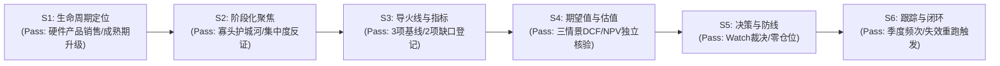

# 希捷科技（NASDAQ: STX）六步研究与基本面估值分析报告

> **报告版本**：v1.0.0  
> **研究基准日**：2026-10-11（行情交易基准日：2026-10-09 常规交易收盘）  
> **研究对象**：Seagate Technology Holdings plc（爱尔兰普通股，NASDAQ: STX，CIK: 0001137789）  
> **会计报告分部**：单一会计分部（存储产品；数据中心与边缘物联网为终端市场维度）  
> **数据来源**：希捷官方 FY2026 全年及 Q4 业绩新闻稿摘录、SEC Form 10-K 年度报告摘录、Google Finance 浏览器页面摘录  
> **核对状态**：双重算法交叉验证（numpy-financial NPV 折现核对、FinanceToolkit 指标校验、反向 DCF 求根重算一致）  
> **研究裁决**：**观察（Watch）**——未证实安全边际，关键未知变量待解，组合未评估不输出仓位。

---

## 0. 基础信息与数据溯源声明（Data Lineage & Audit）

### 0.1 证券身份与行业归属
- **发行主体**：Seagate Technology Holdings plc（爱尔兰公众有限公司）。
- **上市代码**：NASDAQ: STX。非 ADR，非 REIT。
- **业务模式与行业**：硬件产品销售（Hardware / Product Sales），主要从事大容量机械硬盘（HDD）及企业存储系统研发与制造。
- **报告分部**：根据 SEC 10-K 披露，公司仅有**一个会计报告分部**。数据中心（Data Center，占营收 80%）与边缘物联网（Edge IoT，占营收 20%）为终端市场应用维度，非独立利润中心。

### 0.2 数据来源真实性与可得时点（Point-in-Time）
1. **官方财务业绩**：来自希捷投资者关系官方新闻稿（发布于 2026-07-28），归档于 [official-results-excerpt.md](official-results-excerpt.md)。涵盖 FY2026 营收、利润、现金流及资产负债表关键数据。
2. **监管年报披露**：来自 SEC EDGAR 官方 Form 10-K（FY2026 财年为 53 周，截至 2026-07-03），归档于 [sec-10k-excerpt.md](sec-10k-excerpt.md)。涵盖出货容量（EB）、客户集中度、技术认证与债务结构。
3. **二级行情来源**：来自 Google Finance 官方网页实际核对（2026-10-09 美东 16:00 常规交易收盘价 783.00 美元），归档于 [google-finance-browser-excerpt.md](google-finance-browser-excerpt.md)。
   - *特别披露*：本轮次 Google Sheets MCP 因连接传输失败，行情数据来自实际核对的公开浏览器页面摘录，不伪称为 MCP 成功取数；亦不采用盘后变动或非正式盘报价。
4. **模型输入与假设**：明确分离并固化于 [inputs.json](inputs.json)。
5. **计算与交叉复核**：完整记录于 [calculations.json](calculations.json) 与 [verification.json](verification.json)。
6. **目录登记**：已全量归档至项目内本地数据目录 `data/catalog/`（5 项原始证据清单已入库，研究快照生成 revision-000001）。

---

## 1. 第①步：生命周期定位（Lifecycle Stage Positioning）

### 1.1 核心产品渗透率与出货容量依据
- **行业所处阶段**：**成熟期（Mature Stage）中的高容量结构性升级周期**。
- **出货容量增长（EB 维度）**：
  - Nearline HDD（近线大容量硬盘）出货容量：从 FY2025 的 497 EB 增长至 FY2026 的 695 EB，同比增长 **+39.84%**。
  - 全部 HDD 出货容量：从 FY2025 的 595 EB 增长至 FY2026 的 789 EB，同比增长 **+32.61%**。
  - Non-nearline HDD（传统 PC/消费级）：从 98 EB 微跌至 94 EB（-4.08%），印证传统市场见顶萎缩。
- **终端结构迁移**：
  - 数据中心（Data Center）营收占比从 FY2025 的 75% 提升至 FY2026 的 **80%**。
  - 边缘物联网（Edge IoT）营收占比从 25% 降至 **20%**。
- **判断依据与实质**：
  - 传统磁记录 HDD 整体台数进入成熟后期，但由于 AI 生成内容、云厂商大规模存力基础设施升级，单位存储密度与 EB 总容量呈现结构性爆发。
  - 公司处于从传统垂直磁记录（PMR/SMR）向热辅助磁记录（HAMR，Mozaic 3+ 系列）转型的关键技术节点。

---

## 2. 第②步：阶段化聚焦（Phase-Specific Focus: Moat & Competition）

在成熟期，唯一核心聚焦维度为：**护城河（Moats）、竞争格局（CRn）、产能周期与产业链利润分配**。

### 2.1 竞争格局与寡头垄断
- 全球大容量机械硬盘呈现典型双寡头/三寡头格局：希捷科技（Seagate）与西部数据（Western Digital / Sandisk 分立后实体）、东芝（Toshiba）。
- 在 30TB+ 超高容量近线硬盘领域，技术门槛极高，新进入者壁垒森严。

### 2.2 护城河与技术替代风险
- **核心护城河**：
  - 领先的 HAMR 技术研发积累与磁头/介质垂直整合制造能力。
  - 超大规模云服务商（Hyperscalers）的高昂认证周期壁垒与长期供货黏性。
- **不可忽视的反面证据与风险（Counterevidence）**：
  1. **客户集中度极高**：FY2026 单一最大客户收入占比达 **14%**（FY2025 为 10%），前五大客户占主导地位，下游议价能力强，客户订单排期调整将剧烈放大业绩波动。
  2. **固态存储（NAND Flash / QLC SSD）替代威胁**：尽管 HDD 每 TB 成本优势依然显著，但若 NAND 晶圆产能过剩导致成本急剧下探，中低容量近线存储可能面临替代侵蚀。
  3. **技术良率与认证风险**：10-K 明示 HAMR 商业化面临客户测试资格认证时间线、良品率爬坡不及预期风险。

### 2.3 会计穿透与资产质量核查
- **营收与利润质量**：
  - FY2026 营收 12,195 百万美元（同比 +34.06%），营业利润 4,094 百万美元（营业利润率 33.57%，上年为 20.84%），GAAP 净利润 3,184 百万美元（净利率 26.11%）。
  - *口径注意*：FY2026 为 **53 周**（FY2025 为 52 周），多出一周经营数据对营收和费用存在非同周基数扰动，未作同周剔除。
- **存货实质**：
  - 期末存货 1,571 百万美元（上年 1,440 百万美元）。必须明确：**此为希捷公司自身库存，不可替代未披露的下游渠道库存**。渠道库存数据目前缺失。

---

## 3. 第③步：导火线与景气度闭环（Triggers & Operating Cadence）

### 3.1 PEST 导火线与景气度催化
- **技术驱动（Technology）**：AI 算力集群训练与推理产生海量未标注冷热数据，驱动近线存储容量（EB）需求爆发。
- **定价行动（Pricing Actions）**：公司年内通过高容量产品组合和主动提价，驱动毛利率从上年 35.2% 大幅扩张至 45.6%（Q4 单季达 52.3%）。
- **监管与法律（Regulation / Legal）**：2023 年 BIS 和解协议涉及后续合规审计义务（3 项审计已完成 2 项），5 年有条件暂缓拒绝令仍与履约状态严格挂钩；本财年计提诉讼相关费用 105 百万美元。

### 3.2 核心景气度指标监控清单（ quarterly tracking ）

| 监控指标 ID | 业务释义 | FY2026 基线值 | 监控频次 | 跟踪逻辑与失效应答 |
|---|---|---:|---|---|
| `fcf` | 自由现金流（CFO - Capex） | 3,105 百万美元 | 季度 | 检验利润是否真实转化为股东现金；结合资本开支与 SBC 穿透核算 |
| `operating_margin` | GAAP 营业利润率 | 33.57% (Q4: 43.0%) | 季度 | 检验产品组合提价能力与规模效应传导，防止成本反噬 |
| `net_debt` | 账面净债务（有息债务 - 现金） | 1,861 百万美元 | 季度 | 跟踪债务削减进程及 2028 可交换票据现金偿还压力 |
| `hardware_driver_1` | 硬盘出货台数 | *原文未披露数值* | 季度 | 明确区分 EB 容量与硬盘台数，不以 789 EB 混充台数 |
| `hardware_driver_2` | 下游渠道库存天数 | *原文未披露数值* | 季度 | 跟踪下游分销与云端真实消化速度，禁止以公司库存顶替 |

- **重大失效触发条件（Invalidation Trigger: `stx_thesis_change`）**：
  - 若官方披露 HAMR 资格认证出现严重延误、良率受阻、主要客户削减订单配额、提价周期出现逆转或净债务恶化，将强制回退并重跑步骤 S1 至 S5。

---

## 4. 第④步：期望值决策与内在价值估值（Valuation & Expectation）

### 4.1 现金流桥与股数代理（Explicit Cash Flow Bridge）
- **经营现金流（CFO）**：3,674 百万美元。
- **资本开支（Capex）**：569 百万美元。
- **报告自由现金流（FCF）**：3,105 百万美元（核对：3,674 - 569 = 3,105 百万美元，核对一致）。
- **股权激励（SBC）**：213 百万美元（现金流表非现金加回项）。
- **股东真实现金代理（Owner Cash Flow Proxy）**：
  $$\text{FCFE Proxy} = \text{FCF} - \text{SBC} = 3,105 - 213 = 2,892 \text{ 百万美元}$$
- **股份稀释基准**：采用 Q4 GAAP 摊薄股份数 **232 百万股** 作为固定基准（期末流通普通股约 2.27 亿股；2028 可转债潜在摊薄未全量前瞻模拟）。
- **口径边界声明**：该代理未扣除未来偿债净现金流，假设未来净借款为零；在股权口径下不再二次扣除净债务，亦不额外增加存量现金；尚未进行跨周期平准化（Cycle-Normalized）。

### 4.2 三情景多阶段 DCF 估值模型（5 年显式预测期 + 永续终值）

所有情景预测基期现金流为 2,892 百万美元，摊薄股数 2.32 亿股：

| 情景名称 | 假设折现率 ($r$) | 前 5 年复合增长率序列 | 永续增长率 ($g$) | 每股内在价值 (USD) | 对应股权价值 (USD) | 独立 NPV 核对误差 |
|---|---:|---|---:|---:|---:|---:|
| **悲观情景（Bear）** | 12.0% | [-20%, 0%, 3%, 3%, 3%] | 2.0% | **\$100.14** | 232.33 亿美元 | 0.0000000000 |
| **中性情景（Base）** | 10.0% | [+15%, +10%, +8%, +6%, +4%] | 3.0% | **\$234.38** | 543.75 亿美元 | 0.0000000000 |
| **乐观情景（Bull）** | 9.0% | [+35%, +30%, +25%, +20%, +15%] | 3.5% | **\$564.30** | 1,309.17 亿美元 | 0.0000000000 |

> *算法验证披露*：全部情景的多阶段折现现金流总额经由开源成熟金融库 `numpy-financial`（v1.1.0）独立执行 `npv(rate, cashflows)` 核对，最大相对误差 $< 10^{-12}$。未给情景赋予主观概率，不输出虚假的单一期望价格。

### 4.3 市场隐含预期解构：反向 DCF 分析（Reverse DCF）
- **当前市场交易价格**：**\$783.00**（2026-10-09 收盘，对应总市值约 1,793 亿美元）。
- **模型反解目标**：在折现率 10.0%、永续增长率 3.0%、当前现金流代理 \$2,892M 的基准条件下，反解市场价格所需的前 5 年恒定复合年化增速。
- **反解结果**：
  $$\text{Implied 5-Year Annual Growth Rate} = \mathbf{41.34\%}$$
  - *正向求根验证*：以 41.33666% 年化增速代入多阶段 DCF，正向重算得出每股价值为 \$783.000000003，价格绝对误差 $< 10^{-8}$ 美元，算法完全收敛。
- **市场预期含义**：当前 \$783.00 的股价不仅超越了乐观情景（\$564.30），而且隐含了**未来连续 5 年自由现金流复合增长超 41%** 的极端乐观预期。对于资本密集、具备显著周期性的硬件存储行业而言，这一隐含假设极为苛刻。

### 4.4 估值敏感性矩阵（9 格折现率 × 永续增长率，单位：美元/股）

| 折现率 \ 永续增长率 | 2.0% | 3.0% | 4.0% |
|---|---:|---:|---:|
| **8.0%** | \$254.29 | \$289.47 | \$340.51 |
| **10.0%（基准）** | \$210.60 | **\$234.38** | \$266.38 |
| **12.0%** | \$180.20 | \$197.35 | \$219.78 |

> 全部 9 组敏感性参数现金流与终值均经 `numpy-financial` 逐格独立折现核对无误。在最宽松的参数组合（8% 折现率、4% 永续增长）下，每股内在价值亦仅为 \$340.51，依然远低于当前市场交易价格 \$783.00。

### 4.5 相对估值交叉验证（FinanceToolkit Crosscheck）
- **TTM 市盈率（GAAP P/E）**：
  $$\text{P/E} = \frac{\$783.00}{\$13.90} = \mathbf{56.33\times}$$
  - 与 Google Finance 页面显示的 56.32x 基本吻合。
  - 存储硬件行业历史景气高点通常伴随极低市盈率（周期见顶假象）或景气低点极高市盈率；当前在经历一整年高增长且 EPS 创出 \$13.90 的背景下，市盈率仍达 56 倍，反映市场给予了极高的人工智能成长溢价。
- **自由现金流收益率（FCF Yield）**：
  - 报告 FCF 收益率：$3,105 / 179,339 = 1.73\%$。
  - 扣除 SBC 股东代理收益率：$2,892 / 179,339 = \mathbf{1.61\%}$。
  - 远低于当前美国 10 年期无风险国债收益率水平，资产缺乏现金流安全边际。

---

## 5. 第⑤步：仓位、防线与离场纪律（Position & Defense）

### 5.1 最终投资决策结论：**观察（WATCH）**
- **公司质地评价**：【良好但受周期与集中度掣肘】。FY2026 经营性业绩改善显著，HAMR 带来技术代际领先机遇；但客户单一集中、可转债偿付与 NAND 潜在竞争约束长期确定性。
- **价格吸引力评价**：【严重不足 / 缺乏安全边际】。显式 DCF 三情景区间（\$100.14 ~ \$564.30）均低于当前市价 \$783.00；反向 DCF 证明当前价格透支了过高预期。
- **行动适用性裁决**：**不满足买入条件，评定为 Watch**。
- **仓位比例（Position Fraction）**：**0% / Null**。
  - *系统规则约束*：未对用户个人投资组合进行评估；未完成行业深跌统计阈值校准，不盲目给入场仓位。

### 5.2 永久资本损失风险识别（Permanent Loss Risks）
1. **高位买入透支利润周期的估值收缩风险**：硬件行业高利润率（毛利率 52.3%）往往刺激同行扩产或客户压价，周期均值回归将导致盈利与估值乘数双杀。
2. **债务与稀释风险**：FY2026 希捷回购及交换票据已支出约 14 亿美元现金并增发 1,260 万普通股；2028 到期票据本金仍须现金结算，流动性占用压力不可忽视。
3. **技术路线认证不及预期**：若客户转向竞品高密度产品或 HAMR 良品率未达规模经济，将丧失市场份额。

### 5.3 进场条件与离场防线（Entry & Exit Triggers）
- **重新考虑进场的必要条件（Entry Conditions）**：
  1. 股价经历充分周期性回调，出现厚实的“错误边际”（Margin of Safety），价格回落至中性内在价值（约 \$234）或悲观价值带以内。
  2. 取得同口径下一财年实际经营财报，验证高毛利率与近线出货容量的真实可持续性。
  3. 完成可转债稀释与现金偿付的完整前瞻模型验证。
- **已有持仓的清仓/止损条件（Exit Conditions）**：
  1. 景气度指标恶化：单季经营现金流或毛利率连续大幅滑坡，显式表明产品提价逆转。
  2. 核心假设破裂：主要云客户削减采购配额，或 HAMR 大规模商用遭遇技术瓶颈。

---

## 6. 第⑥步：景气度闭环跟踪与情绪钟摆定位（Monitoring & Sentiment）

### 6.1 情绪钟摆与对手盘博弈分析
- **情绪钟摆位置**：**极度乐观 / 过热区间**。
  - 股价距离 52 周最高点（\$1,145.00）回调约 31.62%，处于 52 周波动区间（\$209.00 ~ \$1,145.00）的 **61.32%** 位置。
  - 尽管较最高点有所回落，但较 52 周低点（\$209.00）仍暴涨超 270%，市场参与者共识仍沉浸在“AI 存力无限爆发”的叙事中。
- **对手盘博弈画像**：
  - 当前估值由势头交易者（Momentum Traders）与大盘科技 AI 叙事资金定价，其交易逻辑基于季度指引超预期而非自由现金流贴现。
  - 逆向价值投资者在缺乏深度折扣的情形下不应成为接盘对手方，应保持“防御优先、耐心等待最佳投球”。

### 6.2 跟踪复盘时间表与责任归属
- **例行跟踪频次**：按季度跟踪（Quarterly Cadence）。
- **下次资料核对时点**：**2026-10-19**（检查官方公告及 SEC 申报更新）。
- **专项研究复盘时点**：**2026-11-02**（结合最新一季经营表现重新校对 DCF 假设）。
- *说明*：上述时点均为研究复核计划，非财报预约日，系统未配置自动交易任务。

---

## 7. 六步研究契约与系统门槛验收汇总（Contract Gates Audit）

本项目依据 [research.schema.json](../../../schemas/research.schema.json) v1.1.0 标准对全部步骤门槛进行逐项审计：

| 步骤编号 | 核心门槛（Gate） | 审计结果 | 证据与合规事实 |
|---|---|:---:|---|
| **S1** | `single_stage_focus`, `six_dimensions`, `evidence_linkage` | **PASS** | 明确单一会计分部；6 维定性结论均有本地证据，未启用未校准规则 |
| **S2** | `eight_checks`, `counterevidence_balance`, `accounting_distinctions` | **PASS** | 8 项检查齐全；反证（客户集中、债务、NAND替代）并列；53周/GAAP区别对待 |
| **S3** | `transmission_pathway`, `indicator_baselines`, `invalidation_coverage` | **PASS** | 提价与容量传导有证据；缺失指标明确登记缺口原因；失效触发器覆盖前置步骤 |
| **S4** | `equity_cash_applicability`, `scenario_completeness`, `independent_crosschecks`, `sensitivity_complete`, `equity_bridge_rigor` | **PASS** | 明确 FCFE proxy 边界；开源 numpy-financial 交叉验证；9 格敏感性完整；无二次扣债 |
| **S5** | `permanent_loss`, `action_conditions`, `portfolio_scope`, `decision_evidence` | **PASS** | 永久损失与波动分离；行动条件不足输出 watch；组合未评估不给仓位 |
| **S6** | `monitoring_schedule`, `rerun_triggers`, `review_plan` | **PASS** | 计划时点合规晚于截止日；触发器强制重算；复盘机制明确 |

---

## 8. 总结与免责声明

本报告基于项目内已归档的官方公开披露文件及浏览器行情快照，通过形式化研究契约、多阶段现金流折现及开源金融计算库交叉核对生成。
- **最终建议**：维持 **观察（Watch）**，不建立风险敞口。
- **免责声明**：本分析报告不构成任何要约、证券买卖建议或投资决策授权。所有现金流增长率及折现率均为显式模型推演假设，投资有风险，决策须独立。
