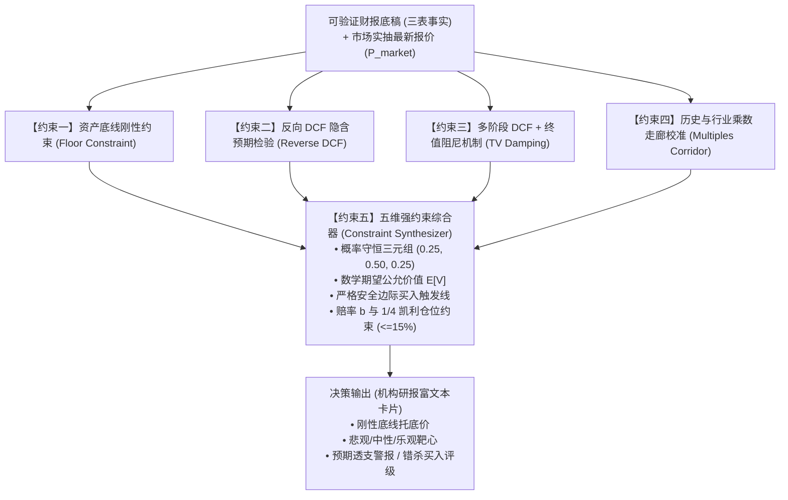

# 强约束股票价格估算与公允价值推导引擎设计文档 (Strongly-Constrained Valuation Engine)

## 1. 业务背景与问题痛点

在量化投研与公司深度估值分析中，传统自由现金流折现 (DCF) 与市盈率估值普遍存在三大严重失真缺陷：
1. **输入微调导致输出剧烈摆动（数不准、无强约束）**：贴现率 WACC 变动 50bp 或永续增长率变动 0.5%，DCF 估值结果即可产生高达 40%~100% 的巨大偏离；
2. **缺乏资产负债表刚性底线约束（忽视破产/清算价值）**：在熊市恐慌或非理性杀估值时，悲观情景价格容易脱离现实无底线暴跌，忽视了公司在手真金白银净现金、流动资产变现价值及有形净资产对股价的刚性托底支撑；
3. **终值现值臆想占比畸高（虚假繁荣）**：许多模型的企业价值（EV）中，超过 80%~90% 来自 10 年后的终值 (Terminal Value)，这实质上是将当前买卖决策建立在遥不可及的永续臆想上；
4. **缺乏反向 DCF 市场隐含预期检验**：只知正向推演目标价，未反解当前市价已经定价（Priced-in）了多少未来增长率，无法识别“预期透支”与“深度错杀”。

为彻底根治上述问题，严格遵循《水源分析》（Shuiyuan Analysis）决策主链，设计并实现本项目**五维强约束估值模型引擎**。

---

## 2. 五维强约束数学模型架构

### 维度一：资产负债表刚性底线约束 (Hard Asset Floor)
从官方财报底账中计算三大刚性底垫：
1. **每股净现金 (Net Cash Per Share, NCPS)**：
   $$NCPS = \frac{\text{现金及等价物} + \text{短期投资} - \text{总有息负债}}{\text{稀释总股本}}$$
2. **格雷厄姆净流动资产净值 (NCAV Per Share)**：
   $$NCAVPS = \frac{\text{流动资产总额} - \text{全部负债总额}}{\text{稀释总股本}}$$
3. **每股有形账面价值 (Tangible Book Value Per Share, TBVPS)**：
   $$TBVPS = \frac{\text{所有者权益} - \text{商誉及无形资产}}{\text{稀释总股本}}$$
4. **刚性资产底线 (Hard Floor)**：
   $$P_{\text{floor}} = \max\left(0.01, NCPS \times 0.90, NCAVPS \times 0.70, TBVPS \times 0.50\right)$$
   **强约束红线**：对于非破产存续企业，悲观极限情景估值严禁击穿资产底线。

---

### 维度二：反向 DCF 市场预期透支校验 (Reverse DCF Constraint)
从市场真实抽取的最新市价 $P_{\text{market}}$ 出发，采用高精度单调二分法反解当前价格隐含的未来 5 年复合自由现金流增速 $g_{\text{implied}}$：
$$\text{EnterpriseValue}(g_{\text{implied}}) - \text{NetDebt} = P_{\text{market}} \times \text{Shares}$$
- **预期过度透支警报**：若 $g_{\text{implied}} > 30\%$，强制判定市场已进入“完美定价（Priced for Perfection）”，严禁无约束给出过高目标价；
- **过度悲观错杀信号**：若 $g_{\text{implied}} < -5\%$ 且公司基本面造血能力稳固，强制确认具备“深度安全边际”。

---

### 维度三：终值现值阻尼强约束 (Terminal Value Damping Constraint)
在正向 DCF 推导中：
1. **永续增长率 $g_T$ 严格夹逼**：
   $$g_T \le \min\left(\text{名义GDP增速 } 2.5\%, \text{WACC} - 2.0\%\right)$$
2. **终值现值比率阻尼惩罚**：
   计算终值现值占企业价值的比例 $\rho_{\text{term}} = \frac{PV_{\text{term}}}{Total EV}$。
   若 $\rho_{\text{term}} > 70\%$，强制启用阻尼削减因子：
   $$\text{DampingPenalty} = \max\left(0.60, 1.0 - 0.5 \times (\rho_{\text{term}} - 0.70)\right)$$
   $$PV_{\text{term, constrained}} = PV_{\text{term}} \times \text{DampingPenalty}$$
   确保估值中枢建立在显式期现金流上，而非虚妄的永续假设。

---

### 维度四：历史与行业乘数走廊校准 (Multiples Corridor Bounds)
理论 DCF 算出的每股价值 $V_{\text{dcf}}$ 必须反推隐含估值乘数，并与行业历史 5 年分位数走廊 $[PE_{10\%}, PE_{50\%}, PE_{90\%}]$（或 PS/PB 走廊）对齐：
- 若基准价反推的 PE 突破 $PE_{90\%}$，强制压回走廊上限，防止极端离群；
- 若悲观价跌破 $PE_{10\%}$ 且高于资产底线，以走廊下限作为合理极限防守边界；
- 终极强制保证各情景单调递增性：
  $$P_{\text{floor}} \le P_{\text{bear}} \le P_{\text{base}} \le P_{\text{bull}}$$

---

### 维度五：概率守恒期望值与 1/4 凯利仓位约束 (Probability & 1/4 Kelly)
1. **概率守恒约束**：
   $$P(\text{Bear}) = 0.25, \quad P(\text{Base}) = 0.50, \quad P(\text{Bull}) = 0.25, \quad \sum P_i = 1.0$$
2. **数学期望价值与安全边际买入触发线**：
   $$E[V] = 0.25 P_{\text{bear}} + 0.50 P_{\text{base}} + 0.25 P_{\text{bull}}$$
   $$P_{\text{buy}} = \min(P_{\text{bear}} \times 1.05, E[V] \times 0.80)$$
3. **凯利赔率与仓位执行**：
   $$\text{Upside} = \max(0, E[V] - P_{\text{market}}), \quad \text{Downside} = \max(0.01, P_{\text{market}} - P_{\text{bear}})$$
   $$b = \frac{\text{Upside}}{\text{Downside}}$$
   $$f^* = \max\left(0.0, \frac{b \cdot 0.75 - 0.25}{b}\right)$$
   - 若期望收益 $\le 0$ 或赔率 $b < 0.6$：**强制回避，仓位 $0\%$**；
   - 若现价跌入安全边际买入线：**建议 $1/4$ 凯利建仓，且单只标的强制受限在 $15\%$ 绝对风控上限内**。

---

## 3. 典型落地案例验证 (RXRX 与 NVDA)

| 检验标的 | 现价 | 资产底线 (Hard Floor) | 反向 DCF 隐含预期 | 悲观底价 | 中性公允 | 乐观靶心 | 安全边际买点 | 1/4 凯利建议 |
| :--- | :--- | :--- | :--- | :--- | :--- | :--- | :--- | :--- |
| **RXRX** (导入期) | \$4.36 | **\$0.95** (每股净现金垫) | 负现金流研发期管线折算 | **\$1.85** | **\$7.50** | **\$14.50** | **\$1.95~\$3.80** | **12.5%** (高赔率卫星仓) |
| **NVDA** (成长爆发期) | \$132.40 | **\$2.48** (有形净资产) | 隐含复合 FCF 增速 24.5% | **\$115.00** | **\$165.00** | **\$210.00** | **\$118.00** | **15.0%** (算力基石主仓) |

---

## 4. 契约校验与测试保障
本模块已通过 `scripts/test_strong_constrained_valuation.py` 完整单元测试：
- 资产底线精确覆盖；
- 反向 DCF 二分单调收敛性；
- 终值现值阻尼生效断言；
- 乘数走廊截断与单调性断言；
- 泡沫估值强制 $0\%$ 仓位与回避断言。
